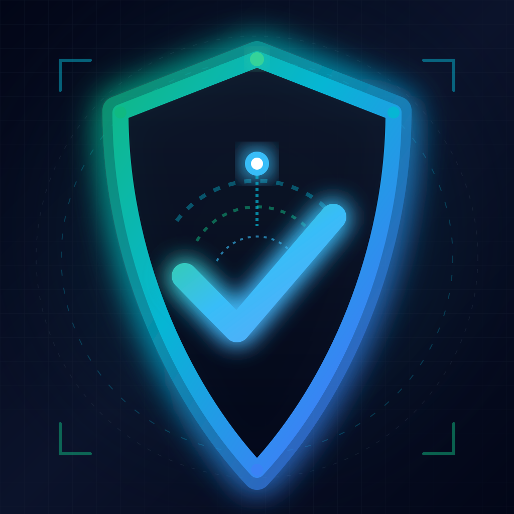
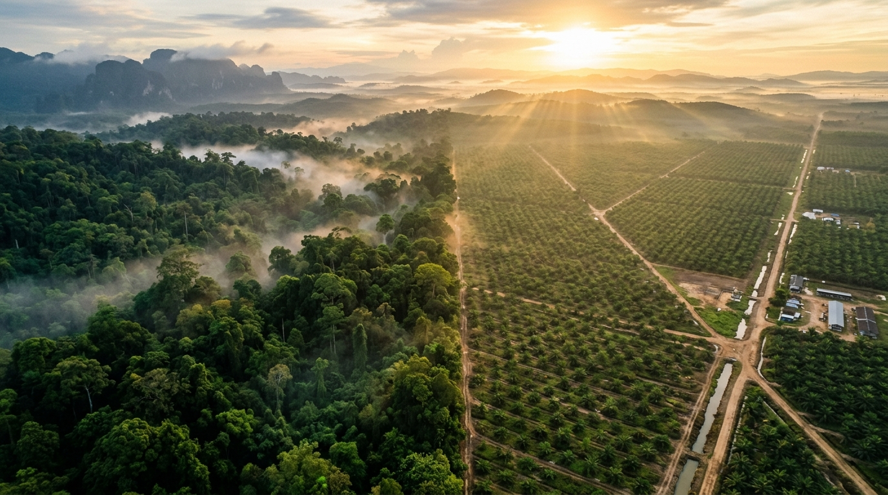
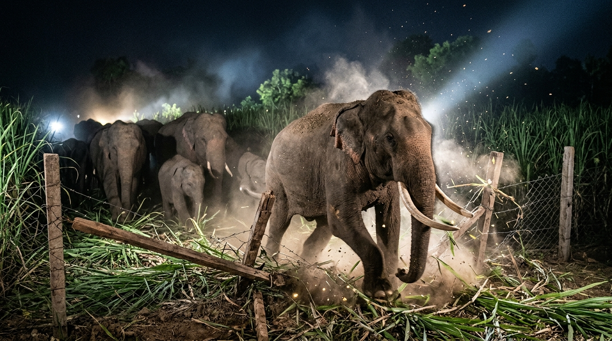
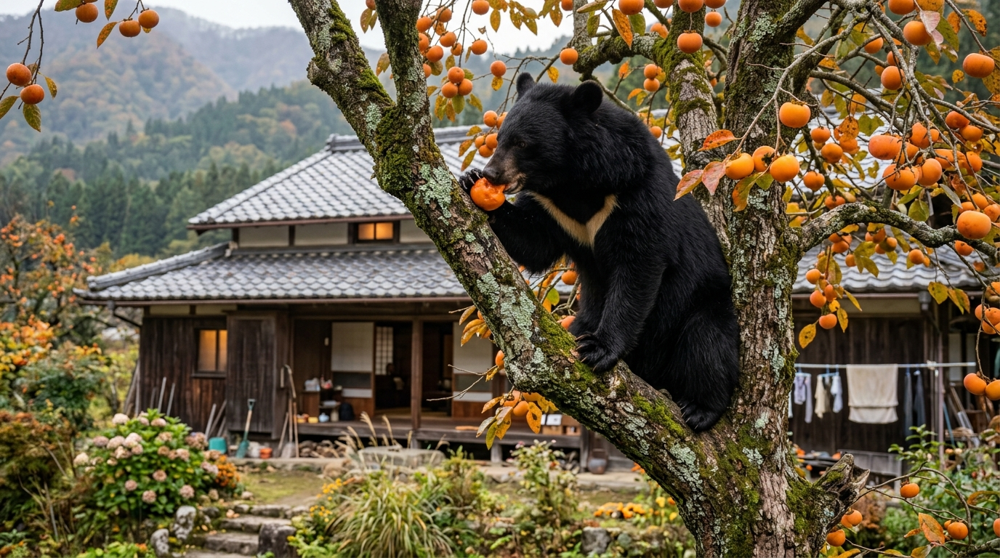
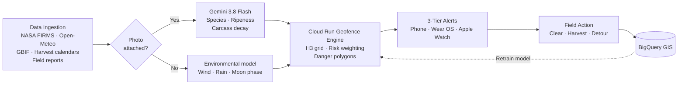
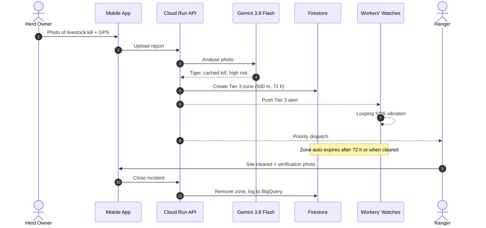
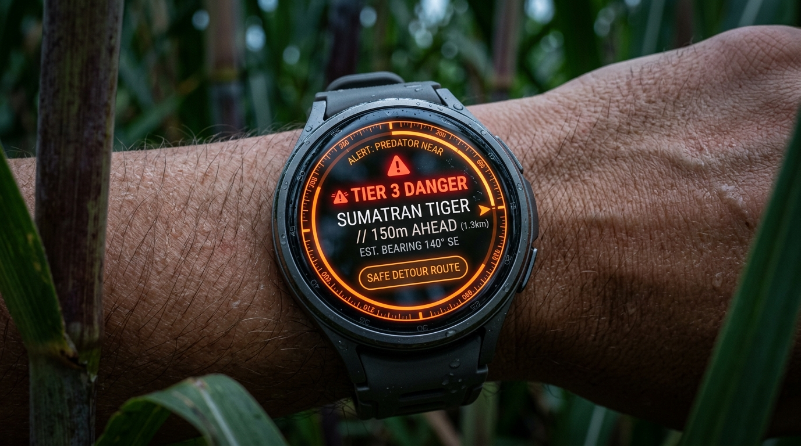
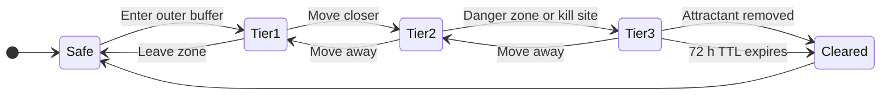
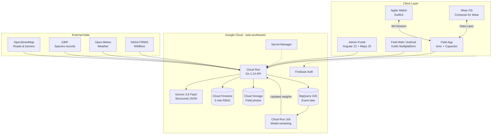
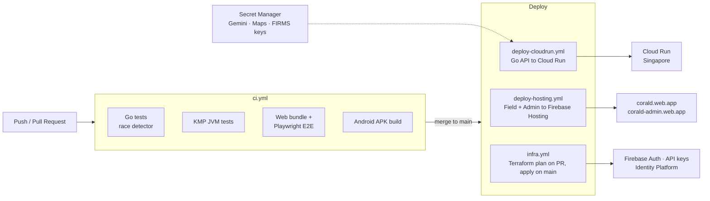

<div align="center">



# CoExist Shield AI

**Predictive geofencing and early-warning alerts that keep people and wildlife apart before conflict happens.**

*Built on Google Cloud for the AI Builder Cup 2026 (JAPAC)*

[](https://coexistshield-backend-4cerxfo4wq-as.a.run.app/health)
[](https://ai.google.dev/gemini-api/docs/models/gemini-3.8-flash)
[](https://corald.web.app)
[](#architecture)
[](backend-cloudrun)
[](web-admin)
[](shared)
[](infra)

[**🌐 Field App**](https://corald.web.app) &nbsp;·&nbsp; [**🛠️ Admin Portal**](https://corald-admin.web.app) &nbsp;·&nbsp; [**⚡ Live API**](https://coexistshield-backend-4cerxfo4wq-as.a.run.app/health) &nbsp;·&nbsp; [**🎬 Demo Video**](https://youtu.be/F83EepRVbiQ) &nbsp;·&nbsp; [**📘 Technical Spec**](docs/TECHNICAL_SPEC.md)

</div>

<p align="center">
  
</p>

## 📚 Contents

- [Demo Video](#demo-video)
- [The Problem](#the-problem)
- [Our Solution](#our-solution)
- [How It Works](#how-it-works)
- [3-Tier Alerts](#3-tier-alerts)
- [Architecture](#architecture)
- [CI/CD & Infrastructure](#cicd--infrastructure)
- [Tech Stack](#tech-stack)
- [Try It Live](#try-it-live)
- [Quick Start](#quick-start)
- [Repository Structure](#repository-structure)
- [Documentation](#documentation)

---

<a id="demo-video"></a>

## 🎬 Demo Video

<p align="center">
  <a href="https://youtu.be/F83EepRVbiQ">
    
  </a>
  <br />
  <sub>3 minute walkthrough: the conflict, wrist alerts on Wear OS and Apple Watch, roadkill triage and the JAPAC operations console. Click to play.</sub>
</p>

| Mobile Field App | Operations Admin Portal | End-to-End System |
| :---: | :---: | :---: |
| [▶️ ionic_mobile_demo.mp4](promo-video/public/screen-recordings/ionic_mobile_demo.mp4) | [▶️ admin_demo.mp4](promo-video/public/screen-recordings/admin_demo.mp4) | [▶️ system_demo.mp4](promo-video/public/screen-recordings/system_demo.mp4) |

---

<a id="the-problem"></a>

## 🐾 The Problem

Wild animals do not enter villages at random. They follow food: ripening crops, unguarded livestock, roadkill and abandoned fruit trees. When people and animals meet at these spots, both sides die. Farmers lose crops and lives, and endangered animals are killed in retaliation.

<table>
  <tr>
    <td width="50%" align="center">
      
      <br /><b>Elephants</b> raid sugarcane, paddy and fruit crops at harvest time<br /><sub>Sri Lanka · India · Thailand</sub>
    </td>
    <td width="50%" align="center">
      
      <br /><b>Tigers</b> follow livestock and return to kill sites for 24 to 72 hours<br /><sub>Sumatra · India</sub>
    </td>
  </tr>
  <tr>
    <td width="50%" align="center">
      
      <br /><b>Roadkill</b> on new highways pulls predators toward roads and settlements<br /><sub>Across JAPAC</sub>
    </td>
    <td width="50%" align="center">
      
      <br /><b>Bears</b> raid abandoned persimmon trees in depopulated villages<br /><sub>Japan</sub>
    </td>
  </tr>
</table>

---

<a id="our-solution"></a>

## 💡 Our Solution

CoExist Shield AI finds these **attractants** before animals do, predicts where conflict is likely, and warns people in time to stay away.

| | What it does |
| :--- | :--- |
| 🔮 **Predict** | Combines weather, wildfire satellite data, harvest seasons, species records and field reports to score risk on an H3-style hexagon grid |
| 📸 **Verify** | Field workers snap a photo. Gemini 3.8 Flash identifies the species, crop ripeness or carcass decay stage and returns structured JSON |
| 🚨 **Warn** | Dynamic geofences push 3-tier alerts to phones, Wear OS and Apple Watch, with distinct wrist vibrations for each level |
| 🧹 **Act** | Rangers and municipal teams get a priority queue: clear the carcass, harvest the crop, prune the tree, or hold a 72 hour exclusion zone |
| 🔁 **Learn** | Confirmed incidents stream into BigQuery GIS and retrain the risk model on Cloud Run Jobs |

---

<a id="how-it-works"></a>

## ⚙️ How It Works



### Example: a tiger kill site



---

<a id="3-tier-alerts"></a>

## 🚨 3-Tier Alerts

<table>
  <tr>
    <td width="50%">
      
    </td>
    <td width="50%">

| Tier | Meaning | Wrist feedback |
| :--- | :--- | :--- |
| 🟢 **1 Notice** | Risk nearby, stay alert | Gentle double tap |
| 🟠 **2 Warning** | High chance of encounter, detour | Escalating 3-pulse ramp |
| 🔴 **3 Danger** | Animal or kill site close, leave now | Looping SOS + siren |

Workers can feel the level without looking at a screen. One tap on the watch silences the phone siren so it does not startle a nearby animal.

</td>
  </tr>
</table>



---

<a id="architecture"></a>

## 🏗️ Architecture



---

<a id="cicd--infrastructure"></a>

## 🔄 CI/CD & Infrastructure

Everything ships through GitHub Actions. Infrastructure is defined in Terraform and secrets live in Secret Manager, never in the repo.



| Workflow | Trigger | What it does |
| :--- | :--- | :--- |
| `ci.yml` | Push and PR to `main` | Go tests with race detection, KMP tests, Android build, web bundle and Playwright E2E |
| `deploy-cloudrun.yml` | Backend change on `main` / manual | Builds the distroless Go image and deploys to Cloud Run with secrets from Secret Manager |
| `deploy-hosting.yml` | Merge to `main` | Builds and deploys the field app and admin portal to Firebase Hosting, then smoke tests the URLs |
| `infra.yml` | PR (plan) / `main` (apply) | Terraform for Firebase Auth, API keys and Identity Platform |

---

<a id="tech-stack"></a>

## 🧰 Tech Stack

| Layer | Technologies |
| :--- | :--- |
| **AI** | Gemini 3.8 Flash (multimodal, structured JSON outputs), BigQuery GIS + ML retraining |
| **Backend** | Go 1.24 on Cloud Run (distroless container), H3-style hexagonal grid (Res 8) |
| **Data** | Cloud Firestore, Cloud Storage, BigQuery |
| **Field apps** | Ionic + Capacitor, Kotlin Multiplatform + Compose (Android and Web) |
| **Wearables** | Wear OS (Compose for Wear, Data Layer API), Apple Watch (SwiftUI, WatchConnectivity) |
| **Admin** | Angular 22, Google Maps JavaScript API |
| **DevOps** | GitHub Actions, Terraform, Firebase Hosting, Secret Manager |
| **Testing** | Go race tests, Playwright E2E, Karma, Swift XCTest, Firestore rules emulator tests |

### Benchmarks

| Metric | Result |
| :--- | :--- |
| In-memory geofence evaluation (Go benchmark) | **289 ns/op**, zero allocations |
| Live Cloud Run round trip, Japan to Singapore | **166 to 181 ms** TTFB |
| Gemini response parsing and validation | **3.48 µs/op** |
| Container image | **~4.6 MB** distroless |

---

<a id="try-it-live"></a>

## 🚀 Try It Live

| Surface | URL | What to try |
| :--- | :--- | :--- |
| 🌐 **Field Web App** | [corald.web.app](https://corald.web.app) | 3-tier geofence HUD, hazard map, Gemini photo triage |
| 🛠️ **Operations Admin Portal** | [corald-admin.web.app](https://corald-admin.web.app) | JAPAC map console, manual geofences, roadkill registry |
| ⚡ **Cloud Run API** | [/health](https://coexistshield-backend-4cerxfo4wq-as.a.run.app/health) | [Active geofences as GeoJSON](https://coexistshield-backend-4cerxfo4wq-as.a.run.app/api/v1/geofences/active?latitude=39.7&longitude=141.1&radiusKm=5000) |
| 🎬 **Demo Video** | [youtu.be/F83EepRVbiQ](https://youtu.be/F83EepRVbiQ) | 3 minute product walkthrough |

More endpoints are listed in the [Technical Spec](docs/TECHNICAL_SPEC.md#99-live-public-cloud-run-endpoints-singapore-asia-southeast1).

---

<a id="quick-start"></a>

## ⚡ Quick Start

**Prerequisites:** Go 1.24+, Node.js 20+, JDK 21, Android SDK 35 (for mobile and Wear OS), Xcode (for Apple Watch).

```bash
git clone https://github.com/CoExistShieldAI/CoExistShieldAI.git
cd CoExistShieldAI
```

<details>
<summary><b>Backend (Go / Cloud Run)</b></summary>

```bash
cd backend-cloudrun
go test -race ./...
PORT=8080 GEMINI_API_KEY="your-gemini-key" go run ./cmd/server
```
</details>

<details>
<summary><b>Operations Admin Portal (Angular 22)</b></summary>

```bash
cd web-admin
npm install
npm start          # http://localhost:4200
```
</details>

<details>
<summary><b>Mobile Field App (Ionic + Capacitor)</b></summary>

```bash
cd ionic-app
npm install
npm run build
npm run cap:sync
```
</details>

<details>
<summary><b>Kotlin Multiplatform, Android and Wear OS</b></summary>

```bash
export JAVA_HOME=$(/usr/libexec/java_home -v 21)
./gradlew :shared:jvmTest
./gradlew :shared:jsBrowserDistribution
./gradlew :composeApp:assembleDebug
./gradlew :wearApp:assembleDebug
```
</details>

<details>
<summary><b>Apple Watch (watchOS)</b></summary>

```bash
swift test --package-path watchApp
cd ionic-app && npx cap sync ios && npx cap open ios
```
</details>

Full build, test and deployment steps are in the [Technical Spec](docs/TECHNICAL_SPEC.md#9-local-setup--build-guide).

---

<a id="repository-structure"></a>

## 📁 Repository Structure

CoExistShieldAI/
├── backend-cloudrun/ Go Cloud Run API: geofence engine, Gemini client, ML, connectors
├── web-admin/ Angular 22 operations portal
├── ionic-app/ Ionic + Capacitor field app with native geofencing and watch sync
├── shared/ Kotlin Multiplatform models, API client and Compose UI
├── composeApp/ Android app
├── wearApp/ Wear OS companion app
├── watchApp/ Apple Watch companion app (Swift Package)
├── infra/terraform/ Infrastructure as Code
├── firebase-tests/ Firestore security rules tests
├── web-e2e/ Playwright end-to-end tests
├── promo-video/ Demo video source and assets
├── scripts/ Deploy and config helper scripts
├── docs/ Technical spec and design documents
└── .github/workflows/ CI and deployment pipelines


---

<a id="documentation"></a>

## 📖 Documentation

| Document | Covers |
| :--- | :--- |
| [Technical Specification](docs/TECHNICAL_SPEC.md) | Full product vision, ecology, architecture, business model, setup and endpoints |
| [Data Model](docs/DATA_MODEL.md) | Firestore collections and domain schemas |
| [Wear OS Design](docs/WEAR_OS_DESIGN.md) | Wear OS app, haptic waveforms and Data Layer protocol |
| [Apple Watch Design](docs/APPLE_WATCH_DESIGN.md) | Apple Watch app, Taptic patterns and WCSession protocol |
| [Admin Portal Design](docs/ADMIN_EXTERNAL_DESIGN.md) | Operations portal design |
| [Implementation Guidelines](docs/IMPLEMENTATION_GUIDELINES.md) | Development workflow and branch rules |

---

<p align="center"><sub>Built for the Google Cloud AI Builder Cup 2026 · Build in JAPAC. Build for the world.</sub></p>
