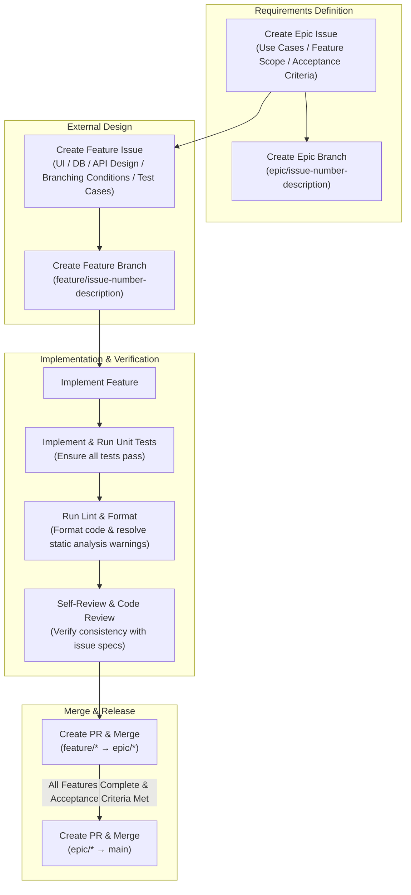

# Implementation Guidelines & Development Workflow

This document defines the standard operating procedures for requirements definition, external design, implementation, testing, review, and branch management across all development tasks.
All developers and AI assistants must adhere to these guidelines when executing implementation tasks.

---

## 1. Development Workflow Overview

This project organizes work hierarchically using **Epic Issues (Requirements Definition)** as parent tasks and **Feature Issues (External Design & Implementation)** as child tasks.



---

## 2. Phase-by-Phase Guidelines

### Phase 1: Requirements Definition (Epic Issue)

Create an **Epic Issue** for each major feature set or milestone to define the overall scope, goals, and acceptance criteria.

#### Key Components
1. **Background & Objective (Why)**
   - Explain why this feature is needed and the problems it solves.
2. **Use Cases**
   - User-centric scenarios: Who, When, Why, How they interact, and What value they receive.
3. **Feature Scope**
   - Clearly delineate what is In-Scope vs. Out-of-Scope.
4. **Acceptance Criteria**
   - Objective, unambiguous, and verifiable criteria (checklist format) to confirm Epic completion.

#### Epic Issue Template
```markdown
## Overview / Objective
<!-- Briefly describe the feature background and desired outcomes -->

## Use Cases
- **UC-01**: [User Role] performs [action/trigger], resulting in [provided feature/outcome].
- **UC-02**: ...

## Features (In-Scope)
- [ ] Feature A: ...
- [ ] Feature B: ...

## Out of Scope
- Explicitly list items not handled in this Epic.

## Acceptance Criteria
- [ ] Criteria 1: Happy path scenario completes successfully.
- [ ] Criteria 2: Appropriate error message is displayed on failure cases.
- [ ] Criteria 3: Related data is accurately created/updated in persistent storage.
```

---

### Phase 2: External Design (Feature Issue)

Break down the Epic Issue into implementable chunks and document each as a **Feature Issue**.
Focus strictly on external design—the interfaces, UI, and observable behaviors from the perspective of users and external systems.

> [!NOTE]
> **Scope of External Design**:
> Thoroughly define UI layout, Database schema, API contracts, and branching business rules.
> Avoid delving into internal implementation details (e.g., internal private helper functions or implementation-specific algorithms).

#### Key Components
1. **Screen / UI Design**
   - Define screen layout, components, interactive controls, and states (loading, empty, error, active).
   - Use design skills/tools to define clear and concrete UI specifications.
2. **Database Design (Data Model)**
   - Collection/table schemas, field types, constraints, relationships, and indexes.
3. **API Design**
   - Endpoints, HTTP methods, request parameters/payloads, response structures, and error codes.
4. **Branching Logic & Business Rules**
   - Role-based access control, input validations, state transitions, and error handling conditions.
5. **Test Cases**
   - **List comprehensive test cases that cover all Acceptance Criteria from the parent Epic Issue.**
   - Include positive (happy path), negative (error handling), and boundary/edge cases.

#### Feature Issue Template
```markdown
## Parent Epic
- Closes #[Epic Issue Number] / Part of #[Epic Issue Number]

## External Design

### 1. UI / Screen Design
<!-- UI components, mockups, state transitions -->
- Main Components:
- View States: Initial / Loading / Error / Empty

### 2. Database Design (Data Model)
<!-- Collection/Table name, schema, field types, constraints -->
- Entity Name:
- Fields:

### 3. API Design
<!-- Endpoints, request/response payload specifications -->
- `METHOD /path/to/resource`
  - Request:
  - Response:

### 4. Branching Logic & Business Rules
- Validation Rules:
- Role & State Conditions:

### 5. Test Cases
- [ ] TC-01: [Happy Path] Resource is created successfully given valid input.
- [ ] TC-02: [Negative] Returns 400 with validation message when input is invalid.
- [ ] TC-03: [Boundary] System handles maximum capacity/limit correctly.
```

---

### Phase 3: Implementation, Testing & Quality Assurance

Implement and verify high-quality code based on the Feature Issue.

1. **Feature Implementation**
   - Build functionality adhering to the external design specifications.
2. **Unit Test Implementation & Verification**
   - Implement unit tests covering the documented test cases.
   - **Ensure 100% of the unit tests pass successfully** locally and in CI.
3. **Code Formatting & Static Analysis (Lint & Format)**
   - **Always run project-specific lint and formatting tools prior to committing.**
   - Resolve all syntax/type issues and formatting inconsistencies.
4. **Code Review & Consistency Check**
   - Perform a thorough self-review to ensure code directly fulfills the Feature Issue and parent Epic without discrepancies.
   - Remove unused code, temporary comments, and debug statements.

---

### Phase 4: Branch Strategy & Pull Request Workflow (Git Workflow)

Maintain clean, traceable Git history using hierarchical branch management.

#### Branch Naming Conventions
- **Epic Branch**: `epic/<epic-issue-number>-<short-description>` (e.g., `epic/12-user-auth`)
- **Feature Branch**: `feature/<feature-issue-number>-<short-description>` (e.g., `feature/15-login-form`)

#### Merge Flow
```
main
  │
  └── epic/12-user-auth
        │
        ├── feature/15-login-form  ──(PR/Merge)──> epic/12-user-auth
        ├── feature/16-auth-api    ──(PR/Merge)──> epic/12-user-auth
        └── feature/17-auth-store  ──(PR/Merge)──> epic/12-user-auth
  │
  └───────────────────────────────(PR/Merge)──> main
```

1. **Create Epic Branch**:
   - Branch off from the latest `main`: `epic/<epic-number>-<epic-name>`.
2. **Create Feature Branch & Implement**:
   - Branch off from the corresponding Epic branch: `feature/<feature-number>-<feature-name>`.
3. **Merge Feature Branch (feature → epic)**:
   - Once implementation, unit tests, and lint/format pass, open a Pull Request targeting the **Epic branch**.
   - Review and merge into the Epic branch.
4. **Merge Epic Branch (epic → main)**:
   - Once all child Feature branches are merged and all Epic Acceptance Criteria are satisfied, open a Pull Request targeting **`main`**.
   - Conduct final verification, code review, and merge into `main`.

---

## 3. Developer Checklist

Verify each item before concluding any task:

- [ ] **Requirements & Design Alignment**
  - [ ] Are all Acceptance Criteria from the Epic Issue addressed?
  - [ ] Does the implementation match the external design (UI, DB, API, branching rules) in the Feature Issue?
- [ ] **Testing**
  - [ ] Are unit tests implemented for all listed test cases?
  - [ ] Do all tests pass without errors or regressions?
- [ ] **Code Quality**
  - [ ] Were lint and format commands executed before committing?
  - [ ] Are there any remaining type errors, compiler warnings, or linter errors?
- [ ] **Git & PR Hygiene**
  - [ ] Is the branch created from and targeting the correct base branch (`feature` → `epic`, `epic` → `main`)?
  - [ ] Does the PR description clearly reference the associated Issue number?
